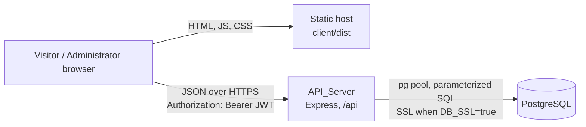
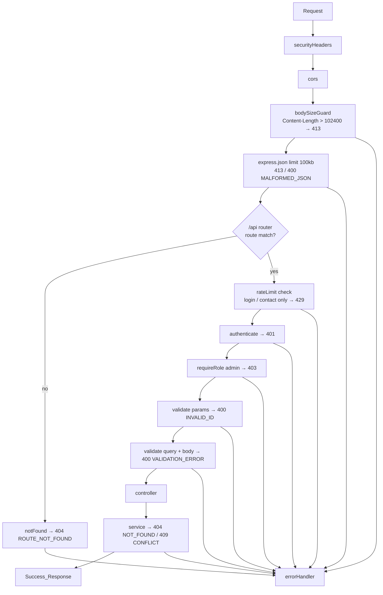
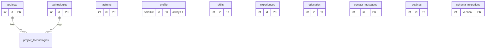

# Design Document: Developer Portfolio CMS

## Overview

The Portfolio_System is a single-owner portfolio site with an admin CMS, built as a monorepo with three layers:

- **Frontend** (`client/`): a React single-page application built with Vite. It renders the Public_Site and a lazy-loaded Admin_Dashboard, and it talks to the API only through the API_Client.
- **API_Server** (`server/`): an Express REST API under `/api`, split into routes, controllers, services, middleware and validators.
- **Database**: PostgreSQL, reached only by the API_Server through a `pg` connection pool.

The design follows the requirements document. Where the requirements left a choice open, this document makes the choice and records the reason.

### Key Design Decisions

| Topic | Decision | Reason |
|---|---|---|
| Module system | ES modules (`"type": "module"`) in both packages | Native in Node.js 20+ and Vite. One import style across the repo. |
| Web framework | Express 5 | Rejected promises from async handlers reach the error middleware without wrapper code (1.7, 1.8). `req.query` is read-only in Express 5, so validated values go to `req.valid`. |
| Runtime versions | Node.js 20 or later (22 LTS recommended), npm 10+, PostgreSQL 14+ | Global `fetch`/`AbortController` in tests, `EXECUTE FUNCTION` triggers, `GENERATED ... AS IDENTITY`. |
| `projects.features`, `experiences.responsibilities` | `TEXT[] NOT NULL DEFAULT '{}'` | Ordered, every element is text by type, and `pg` maps JS arrays to `text[]` natively. JSONB would accept non-text items, so the Database could not enforce the item type. |
| Settings storage | One row per key; `setting_value JSONB` for all four keys | One column type for every key. `social_links` is stored as a JSON array of `{label, url}` and the text keys as JSON strings. |
| Optional text columns | `NOT NULL DEFAULT ''` instead of `NULL` | Requirements return empty strings for missing optional values (10.1, 11.1). Only `experiences.end_date` and `education.end_year` are nullable, because "no end" has meaning. |
| Validation | Hand-written rule combinators in `server/src/validators/` (no library) | The rules need exact semantics that libraries do not give by default: length in Unicode code points after trimming, a UTF-8 byte limit for passwords, unknown-field errors at every nesting level, integers that reject numeric strings, and one `details` entry per invalid field. About 250 lines of pure functions, easy to test with properties. Zod was considered; it would need custom refinements for most of these rules. |
| Migration runner | Custom runner (~100 lines) that applies ordered `.sql` files | Requirement 2 specifies exact behavior (tracking table, one transaction per file, stop on first failure, exit codes, "no pending" report). Plain SQL is all that is needed and no down migrations are required. A library such as node-pg-migrate adds its own conventions and tables that would then have to be matched to the requirements. |
| Rate limiting | Custom in-memory fixed-window limiter | Requirement 8 counts only failed logins and only `201` contact responses, and a window opens at the first *counted* request. express-rate-limit counts at request start. Matching it to these rules would take more code than a 60-line limiter with an injectable clock. |
| Password hashing | `bcryptjs`, cost factor 12 | Pure JavaScript, so `npm install` needs no native build tools on Windows. It produces standard `$2b$` hashes. Login speed is not a performance requirement (35.1 covers public GETs only). |
| JWT | `jsonwebtoken`, HS256, `algorithms: ['HS256']` on verify | `JWT_EXPIRES_IN` is parsed by our own parser into a number of seconds. jsonwebtoken reads a unit-less *string* such as `"120"` as milliseconds ([node-jsonwebtoken README](https://github.com/auth0/node-jsonwebtoken/blob/master/README.md)), but Requirement 5.9 defines a bare number as seconds. |
| Security headers | Small custom middleware plus `app.disable('x-powered-by')` | Requirement 9.5 names exactly three headers. Helmet's own FAQ explains that the headers can be set directly when you only need a few ([You might not need Helmet](https://helmetjs.github.io/faq/you-might-not-need-helmet/)). Helmet's default `X-Frame-Options` is `SAMEORIGIN`, not the required `DENY`. |
| CORS | Small custom middleware | Requirement 9.2 needs exact origin matching after normalization and no allow headers for other origins, including on preflight. |
| JWT storage in browser | `sessionStorage` under key `portfolio.admin.token` | Survives reloads (Requirement 6) but ends when the tab closes, which shortens the exposure window from R1. XSS can read it as easily as `localStorage`, so the main mitigations stay output escaping, no raw HTML and the short token lifetime. See Open Questions. |
| Server tests | Vitest + Supertest, real PostgreSQL test database from `TEST_DATABASE_URL` | Same runner as the client. Supertest drives the Express app in-process. |
| Client tests | Vitest + jsdom + React Testing Library + `@testing-library/user-event` | Native to Vite. No API_Server or Database needed (38.10). |
| Property-based tests | `fast-check` with `numRuns: 100` minimum | Mature JS PBT library that works inside any test runner ([fast-check docs](https://fast-check.dev/)). It also provides `fc.scheduler()` for testing async races. |
| Database SSL variables | `DB_SSL` (`true`/`false`, default `false`), `DB_SSL_REJECT_UNAUTHORIZED` (default `true`) | R4: SSL is set by configuration. The second variable lets hosted providers with self-signed chains work without code changes. |
| Ports | API_Server `PORT` default `5000`; Vite dev server `5173` | Common defaults. |
| Root orchestration | Root `package.json` with scripts only, no dependencies | Gives single commands for "run all tests" (36.10, 38.12). Each layer keeps its own `package.json` (1.1). |

### Interpretations of Requirement Wording

These are design-level readings of the requirements, not new requirements.

- **"Characters"** means Unicode code points everywhere (`[...s].length` in JS). This matches PostgreSQL `VARCHAR(n)` and `char_length`, which also count characters, not bytes.
- **Case-insensitive comparison** uses `toLowerCase()` in JS and `lower()` in SQL. Ordering that must be deterministic uses `lower(x) COLLATE "C"` (code-point order), so the SQL order equals a simple JS reference sort in tests.
- **"Starts with `/admin`"** (30.3) is read as the path segment: the path is `/admin` or begins with `/admin/` or `/admin?`. `/administrator` is therefore not accepted as a post-login destination.
- **Body parsing comes before authentication.** `express.json` runs globally, so a malformed or oversized body on a protected endpoint gets 400/413 before the Auth_Middleware runs. The Validator has not run and no data is exposed, so 7.8 still holds.
- **PUT semantics per resource** follow each requirement's wording (see "PUT semantics" below). They differ by resource; see Open Questions.

### Open Questions for the User

1. **Token storage.** `sessionStorage` (chosen: you sign in again after closing the tab) or `localStorage` (session shared across tabs and browser restarts until the token expires)?
2. **PUT on Experience_Records.** Requirement 16.2 says an update "replaces every submitted field", so this design keeps omitted optional fields unchanged. Skills (15.7) and Education (17.2) set omitted optional fields to empty. Should Experience match Skills and Education? The admin form always sends every field, so this matters only for direct API use.
3. **`DB_SSL_REJECT_UNAUTHORIZED`.** This design adds this variable for hosted providers with self-signed certificate chains. Keep it, or require a proper CA chain?

## Architecture

### System Context



The Frontend and API_Server may run on different origins (R5). The browser never connects to the Database. The API_Server is a single instance, because Rate_Limiter counters live in its memory (R3).

### Request Pipeline (API_Server)



Public routes skip `authenticate` and `requireRole`, and those routes never read the `Authorization` header (5.10, 7.9). This order gives the precedence from Requirement 4.12: body size, JSON syntax, path id, field validation, existence, then uniqueness. Services check existence before uniqueness inside one transaction.

### Repository Layout

```
myPortfolio/
├── package.json              # orchestration scripts only
├── .gitignore                # node_modules/, client/dist/, .env* except .env.example
├── README.md
├── client/
│   ├── package.json
│   ├── .env.example          # VITE_API_BASE_URL
│   ├── index.html
│   ├── vite.config.js        # build-time env check, Vitest config
│   └── src/
│       ├── main.jsx          # createRoot, BrowserRouter, AuthProvider
│       ├── App.jsx           # top-level <Routes>
│       ├── api/              # apiClient.js + one module per resource
│       ├── components/
│       │   ├── common/       # LoadingIndicator, ErrorState, EmptyState, LazyImage, FormField, ...
│       │   ├── layout/       # PublicLayout, Navbar, Footer, SkipLink
│       │   └── admin/        # AdminLayout, Sidebar, Topbar, DataTable, ConfirmDialog, ListEditor, TagInput
│       ├── pages/
│       │   ├── public/       # Home, About, Skills, Projects, ProjectDetails, Experience, Education, Contact, NotFound
│       │   └── admin/        # Login, Overview, *List, *Form, Messages, MessageDetail, Profile, Settings
│       ├── context/          # AuthContext, SiteDataContext, NotificationContext
│       ├── hooks/            # useFetch, useAsyncAction, usePageTitle, useRouteFocus, useFocusTrap, useInView
│       ├── routes/           # AdminApp (lazy entry), ProtectedRoute, GuestOnlyRoute
│       ├── utils/            # validation, formatDate, url, tokenStorage, filters, reorder
│       ├── styles/           # tokens.css, base.css, layout.css, components.css, admin.css
│       └── assets/           # placeholder images (SVG)
└── server/
    ├── package.json
    ├── .env.example
    ├── migrations/           # 001_init_functions.sql ... 010_create_settings.sql
    ├── scripts/              # migrate.js, seed.js (thin CLI wrappers)
    ├── src/
    │   ├── server.js         # entry: load config, create app, start listener
    │   ├── app.js            # createApp({ config, db, clock, logger })
    │   ├── config/           # env.js (loadAppConfig, loadDbConfig, loadSeedConfig)
    │   ├── db/               # pool.js, query.js, transaction.js, typeParsers.js, migrator.js, startupCheck.js
    │   ├── routes/           # index.js + one router per resource
    │   ├── controllers/
    │   ├── services/         # all SQL lives here (and in db/)
    │   ├── middleware/       # securityHeaders, cors, bodySizeGuard, authenticate, requireRole, rateLimit, validate, notFound, errorHandler
    │   ├── validators/       # rules.js + one schema module per resource
    │   └── utils/            # errors.js, slug.js, duration.js, sanitize.js, response.js, logger.js, rateLimiter.js
    └── tests/
        ├── unit/  property/  integration/
        └── helpers/          # testDb.js (reset), tokens.js, factories.js, fakeDb.js
```

The `db/` directory is the "database configuration" directory from 1.4. `server.js` only loads configuration, creates the app and starts the listener (1.6). The startup database check is in `db/startupCheck.js`, and `server.js` calls it.

## Components and Interfaces

### Backend Components

#### Entry and App Factory

```js
// server/src/server.js
const config = loadAppConfig(process.env);        // exits non-zero on invalid config (5.9, 9.8, 35.8, 36.5)
const db = createDb(config.db);                   // pg Pool wrapper
const app = createApp({ config, db });
await startServer(app, { db, port: config.port }); // test query within 10 s, then listen (36.7)
```

`createApp` takes its dependencies as arguments, so tests can inject a failing `db` (38.8), a fake clock for the Rate_Limiter, and a low-cost password hasher.

#### Database Access (`src/db/`)

| Module | Interface | Notes |
|---|---|---|
| `pool.js` | `createDb(dbConfig) → { query, withTransaction, healthCheck, end }` | `new Pool({ connectionString or host/port/user/password/database, max: DB_POOL_MAX, connectionTimeoutMillis: 5000, ssl })` |
| `query.js` | `query(text, params)` | Acquires a client with `pool.connect()`. An acquire failure (pool timeout, refused connection) becomes `ServiceUnavailableError` (35.9). Query errors pass through unchanged. |
| `transaction.js` | `withTransaction(async (tx) => …)` | `BEGIN` / `COMMIT`, with `ROLLBACK` on any throw, then release. Every multi-statement write uses it (4.8). |
| `typeParsers.js` | `types.setTypeParser(1082, v => v)` | Returns `DATE` columns as `'YYYY-MM-DD'` strings. The default parser turns them into local-time JS `Date`s, which shifts dates across time zones. `COUNT` results are cast to `::int` in SQL. |
| `startupCheck.js` | `startServer(app, { db, port })` | Runs `SELECT 1` with a 10 s timeout. On failure it logs a message without the password or URL and exits 1. On success it calls `app.listen`. |
| `migrator.js` | `runMigrations({ db, dir, logger }) → { applied: string[] }` | See Migration Runner. |

SSL: when `DB_SSL=true` the pool gets `ssl: { rejectUnauthorized: DB_SSL_REJECT_UNAUTHORIZED }`. Otherwise `ssl: false`. With `ssl` set, `pg` does not retry without TLS (36.6). The README tells users not to put `sslmode` in `DATABASE_URL`, so `DB_SSL` is the only switch.

#### Middleware

| Middleware | Behavior | Requirements |
|---|---|---|
| `securityHeaders` | Mounted first. Sets `X-Content-Type-Options: nosniff`, `X-Frame-Options: DENY`, `Referrer-Policy: no-referrer` on every response. `app.disable('x-powered-by')`. | 9.5 |
| `cors` | Normalizes `FRONTEND_URL` once at startup: split on `,`, trim, drop a trailing `/`, keep `new URL(x).origin`. If the request `Origin` is in that set, it sets `Access-Control-Allow-Origin: <origin>` and `Vary: Origin`, and on `OPTIONS` also sets `Allow-Methods: GET,POST,PUT,PATCH,DELETE` and `Allow-Headers: Authorization, Content-Type`, `Max-Age: 600`, then responds 204. For any other origin it sets only `Vary: Origin`, and an `OPTIONS` preflight gets 204 with no allow headers. No credentials mode, because the token travels in a header. | 9.2 |
| `bodySizeGuard` | If `Content-Length` > 102400, calls `next(new PayloadTooLargeError())`. `express.json({ limit: '100kb' })` also catches chunked JSON bodies (body-parser reports `type: 'entity.too.large'`). | 4.6 |
| `rateLimit(limiter, { countWhen })` | Key = `req.ip`. If the key is blocked, responds 429 with `Retry-After`. Otherwise it registers `res.on('finish')` and calls `limiter.record(key)` when `countWhen(res)` is true. Login counts `res.statusCode === 401`; the login route has no auth middleware, so 401 there always means invalid credentials. Contact counts `res.statusCode === 201`. | 8.1–8.3, 8.7 |
| `authenticate` | Parses `Authorization`, which must match `/^Bearer ([^\s]+)$/i`. Then `jwt.verify(token, secret, { algorithms: ['HS256'] })` with expiry checked against the current time, and checks that the `sub` claim is a valid id and `role` is a non-empty string. Then `SELECT id, email, role FROM admins WHERE id = $1`. Any failure → 401 `UNAUTHORIZED`. On success sets `req.auth = { id, email, role }`: `id` and `email` from the database, `role` from the token. | 7.2, 7.3, 7.5, 7.7 |
| `requireRole(role)` | `req.auth.role !== role` → 403 `FORBIDDEN`. | 7.4 |
| `validate({ params, query, body })` | Runs the params schema first (400 `INVALID_ID`), then query and body (400 `VALIDATION_ERROR` with all `details`). Stores normalized values in `req.valid`. | 4.2, 4.10, 4.12, 9.6 |
| `notFound` | Unmatched `/api/*` → 404 `ROUTE_NOT_FOUND`. | 4.4 |
| `errorHandler` | Maps errors to Error_Responses (see Error Handling). | 4.8, 4.9, 4.11, 4.13, 9.9 |

`TRUST_PROXY=true` sets `app.set('trust proxy', 1)`, so `req.ip` is the client address from one reverse-proxy hop. Otherwise `trust proxy` stays `false` and `req.ip` is the socket address, which means `X-Forwarded-For` is ignored (8.5, 8.6). Trusting exactly one hop, not `true`, stops clients from spoofing the left-most `X-Forwarded-For` entry.

#### Route Definition Pattern

```js
// server/src/routes/projects.routes.js
const admin = [authenticate, requireRole('admin')];
router.get('/projects', validate({ query: publicProjectQuery }), projects.listPublic);
router.get('/projects/:identifier', projects.getPublic);           // identifier parsed in controller (P3)
router.post('/projects', ...admin, validate({ body: projectBody }), projects.create);
router.put('/projects/:id', ...admin, validate({ params: idParams, body: projectBody }), projects.update);
router.patch('/projects/:id/publish', ...admin, validate({ params: idParams, body: publishBody }), projects.setPublished);
router.delete('/projects/:id', ...admin, validate({ params: idParams }), projects.remove);
router.get('/admin/projects', ...admin, projects.listAdmin);
router.get('/admin/projects/:id', ...admin, validate({ params: idParams }), projects.getAdmin);
```

Controllers read `req.valid`, call one service function, and send `ok(res, data, status)`. Controllers contain no SQL (1.5).

#### API Endpoint Catalog

Auth column: **public** = no authentication; **admin** = `authenticate` + `requireRole('admin')`. Every success body is `{ success: true, data, meta? }`.

| Method | Path | Auth | Request | Success | Error statuses |
|---|---|---|---|---|---|
| GET | `/api/health` | public | – | 200 `{ status: "ok" }` | 503 |
| POST | `/api/auth/login` | public, 5 failed / 15 min / IP | `{ email, password }` | 200 `{ token, admin: { id, email, role } }` | 400, 401, 429 |
| GET | `/api/auth/me` | admin | – | 200 `{ id, email, role }` | 401, 403 |
| GET | `/api/profile` | public | – | 200 Profile | 404 |
| PUT | `/api/profile` | admin | Profile fields | 200 Profile | 400, 404 |
| GET | `/api/settings` | public | – | 200 Settings | – |
| PUT | `/api/settings` | admin | subset of Settings keys | 200 Settings | 400 |
| GET | `/api/projects` | public | `?category=` | 200 PublicProject[] | 400 |
| GET | `/api/projects/:identifier` | public | – | 200 PublicProject | 400, 404 |
| GET | `/api/admin/projects` | admin | – | 200 AdminProject[] | – |
| GET | `/api/admin/projects/:id` | admin | – | 200 AdminProject | 400, 404 |
| POST | `/api/projects` | admin | ProjectInput | 201 AdminProject | 400, 409 |
| PUT | `/api/projects/:id` | admin | ProjectInput | 200 AdminProject | 400, 404, 409 |
| PATCH | `/api/projects/:id/publish` | admin | `{ is_published: boolean }` | 200 AdminProject | 400, 404 |
| DELETE | `/api/projects/:id` | admin | – | 200 `{ id }` | 400, 404 |
| GET | `/api/technologies` | admin | – | 200 Technology[] | – |
| GET | `/api/skills` | public | – | 200 Skill[] | – |
| POST | `/api/skills` | admin | SkillInput | 201 Skill | 400 |
| PUT | `/api/skills/:id` | admin | SkillInput | 200 Skill | 400, 404 |
| DELETE | `/api/skills/:id` | admin | – | 200 `{ id }` | 400, 404 |
| GET | `/api/experiences` | public | – | 200 Experience[] | – |
| POST | `/api/experiences` | admin | ExperienceInput | 201 Experience | 400 |
| PUT | `/api/experiences/:id` | admin | ExperienceInput | 200 Experience | 400, 404 |
| DELETE | `/api/experiences/:id` | admin | – | 200 `{ id }` | 400, 404 |
| GET | `/api/education` | public | – | 200 Education[] | – |
| POST | `/api/education` | admin | EducationInput | 201 Education | 400 |
| PUT | `/api/education/:id` | admin | EducationInput | 200 Education | 400, 404 |
| DELETE | `/api/education/:id` | admin | – | 200 `{ id }` | 400, 404 |
| POST | `/api/contact` | public, 5 counted / 60 min / IP | `{ name, email, subject, message, website }` | 201 `{ received: true }` | 400, 429 |
| GET | `/api/contact` | admin | `?page&limit&is_read` | 200 ContactMessage[] + `meta { total, page, limit }` | 400 |
| GET | `/api/contact/:id` | admin | – | 200 ContactMessage | 400, 404 |
| PATCH | `/api/contact/:id/read` | admin | `{ is_read: boolean }` | 200 ContactMessage | 400, 404 |
| DELETE | `/api/contact/:id` | admin | – | 200 `{ id }` | 400, 404 |
| GET | `/api/dashboard/stats` | admin | – | 200 DashboardStats | 401, 403 |

All admin endpoints can also return 401 and 403. Any endpoint can return 413, 400 `MALFORMED_JSON`, 500 and 503.

- The Honeypot_Field is named `website`. Both the stored path and the discarded path return exactly `{ success: true, data: { received: true } }`, so the two responses cannot be told apart (8.4, 18.1).
- `POST /api/contact` ignores unknown fields (18.5). Every other endpoint rejects them (9.6).

#### PUT Semantics

| Resource | Omitted optional field on PUT | Source |
|---|---|---|
| Profile | unchanged | 10.2 |
| Settings | omitted keys unchanged; at least one key required | 11.2, 11.8 |
| Project | text and URL fields → `''`; `features`, `technologies` → `[]`; `is_published` and `slug` (omitted or empty) → unchanged | 13.4, 13.16 |
| Skill | → empty | 15.7 |
| Experience | unchanged (submitted fields replaced, including the whole `responsibilities` list) | 16.2 |
| Education | → empty / `null` | 17.2 |

#### Validator (`src/validators/`)

`rules.js` exports composable rules. A rule is a pure function `(value, path) → { ok: true, value } | { ok: false, errors: [{ field, reason }] }`.

```js
str({ min = 0, max, required = true })  // must be a string; trims; length = [...s].length
int({ min, max })                       // typeof number && Number.isInteger; rejects "5", 5.5, NaN
bool()                                  // typeof boolean only; "true" fails
oneOf(values)                           // exact, case-sensitive
url()                                   // '' allowed when optional; else Valid_URL
email()                                 // Valid_Email
isoDate()                               // /^\d{4}-\d{2}-\d{2}$/ and a real calendar date (UTC round-trip)
list(item, { max })                     // array; validates every item; field paths like features[3]
object(shape, { unknown: 'reject' })    // collects errors from every field plus one per unknown key, recursively
refine(schema, check)                   // cross-field rules, run only when field rules pass
```

Shared definitions (also mirrored in `client/src/utils/validation.js`):

- **Valid_URL**: a string of at most 2048 characters for which `new URL(s)` succeeds, the protocol is `http:` or `https:`, and the hostname is not empty.
- **Valid_Email**: a string of at most 254 characters matching `/^[^\s@]+@[^\s@.]+(\.[^\s@.]+)+$/`. That means a local part, `@`, and a domain with at least one dot and no empty labels.
- **Password**: a non-empty string of at most 72 bytes, measured with `Buffer.byteLength(s, 'utf8')`. It is never trimmed.

Field reasons use fixed tokens (`required`, `type`, `too_short`, `too_long`, `out_of_range`, `invalid_format`, `invalid_url`, `invalid_email`, `invalid_value`, `duplicate`, `unknown_field`, `before_start`). Each `details` entry also has a readable `message`.

Schemas per resource:

| Schema | Fields (after trimming) |
|---|---|
| `loginBody` | `email` Valid_Email (normalized: trim + lowercase); `password` 1 char to 72 bytes |
| `profileBody` | `name` 1–100, `professional_title` 1–100, `email` Valid_Email (all three required); `personal_introduction`, `biography`, `career_interests`, `professional_goals` 0–5000; `profile_image_url`, `github_url`, `linkedin_url` empty or Valid_URL |
| `settingsBody` | at least one of: `site_title` 1–100, `hero_introduction` 0–500, `footer_text` 0–300, `social_links` list of 0–10 `{ label 1–50, url Valid_URL }` |
| `publicProjectQuery` | `category` optional, 1–50 after trim |
| `projectBody` | `title` 1–150, `short_description` 1–300, `category` 1–50 (required); `full_description`, `problem_statement`, `objectives`, `challenges`, `solutions` 0–10000; `image_url`, `github_url`, `live_demo_url` empty or Valid_URL; `display_order` int 0–9999 (required); `is_published` bool (optional); `slug` empty or Slug format (optional); `features` 0–30 items of 1–300; `technologies` 0–30 names of 1–50, no case-insensitive duplicates |
| `publishBody`, `readBody` | `is_published` / `is_read` bool, required |
| `skillBody` | `name` 1–50, `category` 1–50, `display_order` int 0–9999 (required); `proficiency_level` `''` or Proficiency_Level; `icon_url` empty or Valid_URL |
| `experienceBody` | `job_title` 1–100, `company_name` 1–100, `employment_type` Employment_Type, `start_date` isoDate (required); `end_date` null/`''`/isoDate ≥ `start_date`; `description` 0–5000; `responsibilities` 0–20 items of 1–300 |
| `educationBody` | `institution` 1–150, `qualification` 1–150, `start_year` int 1950..Y+10 (required); `field_of_study` 0–150; `description` 0–5000; `end_year` null/`''`/int `start_year`..Y+10. Y = `clock.now()` UTC year. |
| `contactBody` | sanitize, then `name` 1–100, `email` Valid_Email, `subject` 1–150, `message` 10–5000; `website` honeypot; unknown keys dropped |
| `contactListQuery` | `page` digits ≥ 1 (default 1), `limit` digits 1–100 (default 20), `is_read` `'true'`/`'false'` |
| `idParams` | `id` matches `/^[0-9]+$/` and 1 ≤ n ≤ 2147483647 |

Query-string numbers arrive as strings, so `page` and `limit` use a digits-only string rule. Body integers must be JSON numbers.

#### Project_Identifier Parsing

```js
function classifyIdentifier(raw) {
  if (/^[0-9]+$/.test(raw)) {
    const n = Number(raw);
    return n >= 1 && n <= 2147483647 ? { kind: 'id', id: n } : { kind: 'invalid' };  // invalid → 400 (4.10)
  }
  return isSlug(raw) ? { kind: 'slug', slug: raw } : { kind: 'none' };               // none → 404 without a query (12.5)
}
```

Both "not found" and "not published" return the same 404 body: `{ code: 'NOT_FOUND', message: 'Project not found' }` (12.5).

#### Slug_Generator (`src/utils/slug.js`)

```js
const SLUG_RE = /^[a-z0-9]+(?:-[a-z0-9]+)*$/;
const MAX = 160;
const isSlug = (s) => s.length <= MAX && SLUG_RE.test(s) && /[a-z]/.test(s);

function slugify(title) {                      // 13.10 steps 1-3
  return title.toLowerCase().replace(/[^a-z0-9]+/g, '-').replace(/^-+|-+$/g, '');
}
function truncate(s, max) {                    // cut at a hyphen boundary when possible; never end with '-'
  if (s.length <= max) return s;
  let cut = s.slice(0, max);
  if (s[max] !== '-' && cut.includes('-')) cut = cut.slice(0, cut.lastIndexOf('-'));
  return cut.replace(/-+$/, '');
}
function deriveSlug(title, max = MAX) {        // 13.10 + 13.12, no suffix
  const s = truncate(slugify(title), max);
  if (s === '') return 'project';
  return /[a-z]/.test(s) ? s : truncate(`project-${s}`, max);
}
function generateUniqueSlug(title, taken /* Set<string> */) {   // 13.11
  for (let k = 1; ; k++) {
    const suffix = k === 1 ? '' : `-${k}`;
    const candidate = deriveSlug(title, MAX - suffix.length) + suffix;
    if (!taken.has(candidate)) return candidate;
  }
}
```

Truncation runs before the letter check. A title like `"1111…1 a"` could otherwise lose its only letter during truncation. Applying `deriveSlug` to any valid Slug returns it unchanged: it is already lowercase, has no invalid runs and no edge hyphens, fits in 160 characters and contains a letter (13.14).

The project service loads `SELECT slug FROM projects` inside the save transaction, after taking `pg_advisory_xact_lock(hashtext('projects_slug'))`. The pure function therefore sees a consistent set. A unique violation (`23505`) is still mapped to 409 as a safety net.

#### Services (`src/services/`)

| Service | Key operations |
|---|---|
| `authService` | `login(email, password)`: `SELECT … FROM admins WHERE email = $1` with the normalized email, then `hasher.compare(password, row?.password_hash ?? DUMMY_HASH)`. The comparison runs for unknown emails too (5.5). `DUMMY_HASH` is a cost-12 hash of random bytes, made once at startup. Signs `{ sub: String(id), email, role }` with `expiresIn: config.jwtExpiresInSeconds` (a number). `getMe(id)`. |
| `profileService` | `get()`, `update(fields)`: `UPDATE profile SET <allow-listed columns> WHERE id = 1 RETURNING …`. 0 rows → `NotFoundError` (10.12). |
| `settingsService` | `getAll()`: returns stored values merged over defaults (11.1). `update(partial)`: one transaction, `INSERT … ON CONFLICT (setting_key) DO UPDATE` per key. |
| `projectService` | `listPublic({ category })`, `getPublicById/BySlug`, `listAdmin`, `getAdmin(id)`, `create(input)`, `update(id, input)`, `setPublished(id, value)`, `remove(id)`. |
| `technologyService` | `list()`, `ensureByNames(tx, names) → ids` |
| `skillService`, `experienceService`, `educationService` | `list`, `create`, `update`, `remove` |
| `contactService` | `submit(input)`, `list({ page, limit, isRead })`, `get(id)`, `setRead(id, value)`, `remove(id)` |
| `dashboardService` | `stats()`: one statement with seven `(SELECT count(*)::int …)` subqueries, so the counts come from one snapshot (20.4) |
| `seedService` | Seed steps, called by `scripts/seed.js` |

The project list uses one query whatever the project count (35.10):

```sql
SELECT p.*,
       COALESCE(json_agg(json_build_object('id', t.id, 'name', t.name, 'category', t.category)
                ORDER BY lower(t.name) COLLATE "C") FILTER (WHERE t.id IS NOT NULL), '[]') AS technologies
FROM projects p
LEFT JOIN project_technologies pt ON pt.project_id = p.id
LEFT JOIN technologies t ON t.id = pt.technology_id
WHERE p.is_published AND ($1::text IS NULL OR lower(p.category) = lower($1))
GROUP BY p.id
ORDER BY p.display_order ASC, p.created_at DESC, p.id DESC;
```

The project save runs in one transaction (14.4, 14.5):

```
withTransaction(tx):
  pg_advisory_xact_lock(hashtext('projects_slug'))
  if update: row ← SELECT … FROM projects WHERE id=$1 FOR UPDATE; none → NotFoundError       (existence before uniqueness)
  slug ← input.slug || (update ? row.slug : generateUniqueSlug(title, takenSlugs))
  if input.slug and it belongs to another project → ConflictError('slug')                    (13.18)
  INSERT/UPDATE projects (is_published kept when omitted on update, false on create)
  INSERT INTO technologies(name) SELECT unnest($1::text[]) ON CONFLICT ((lower(name))) DO NOTHING
  ids ← SELECT id FROM technologies WHERE lower(name) = ANY($lowerNames)
  DELETE FROM project_technologies WHERE project_id=$1
  INSERT INTO project_technologies SELECT $1, unnest($ids::int[])
  return getAdmin(tx, id)
```

Sorting (all deterministic):

| List | ORDER BY |
|---|---|
| projects (public and admin) | `display_order ASC, created_at DESC, id DESC` |
| technologies | `lower(name) COLLATE "C" ASC, id ASC` |
| skills | `lower(category) COLLATE "C" ASC, display_order ASC, lower(name) COLLATE "C" ASC, id ASC` |
| experiences | `start_date DESC, id DESC` |
| education | `start_year DESC, end_year DESC NULLS FIRST, id ASC` |
| contact_messages | `created_at DESC, id DESC`, with `LIMIT $limit OFFSET ($page-1)*$limit`, plus a separate `count(*)` using the same filter |

#### Rate_Limiter (`src/utils/rateLimiter.js`)

```js
function createFixedWindowLimiter({ windowMs, max, now = Date.now }) {
  const entries = new Map();               // key → { start, count }
  const live = (k) => { const e = entries.get(k); return e && now() < e.start + windowMs ? e : null; };
  return {
    check(k) {                             // { blocked, retryAfterSeconds }
      const e = live(k);
      if (!e || e.count < max) return { blocked: false };
      const secs = Math.ceil((e.start + windowMs - now()) / 1000);
      return { blocked: true, retryAfterSeconds: Math.min(Math.max(secs, 1), windowMs / 1000) };
    },
    record(k) {                            // a window opens at the first counted request
      const e = live(k);
      if (e) e.count += 1; else entries.set(k, { start: now(), count: 1 });
    },
    sweep() { for (const [k] of entries) if (!live(k)) entries.delete(k); },
  };
}
```

There are two instances: `login` (15 min, max 5) and `contact` (60 min, max 5). `sweep` runs every 5 minutes on an `unref()`ed timer. The check-then-record order allows a small overshoot when requests run concurrently. This is acceptable for a single-owner site.

#### Contact Sanitizing (`src/utils/sanitize.js`)

```js
const CONTROL = /[\u0000-\u0008\u000B\u000C\u000E-\u001F\u007F]/g;   // keeps \t \n \r
export const sanitizeText = (s) => s.replace(CONTROL, '').trim();
```

`POST /api/contact` steps:

1. If the body is not a plain object → 400.
2. If `website` is a string of length ≥ 1 → 201 `{ received: true }` with no write.
3. Pick only `name`, `email`, `subject` and `message`, sanitize each string, and validate.
4. Run `INSERT … RETURNING id`, with `is_read` and `created_at` taken from the column defaults.

A `website` value that is not a string counts as "not empty". Treating it as a bot keeps the rule "any value of at least one character" simple.

#### Migration Runner (`src/db/migrator.js`, `scripts/migrate.js`)

```
connect (exit 1 with "Cannot connect to database: <reason without credentials>" on failure)   (2.12)
SELECT pg_advisory_lock(<constant>)                       -- prevents two concurrent runs
CREATE TABLE IF NOT EXISTS schema_migrations (version INTEGER PRIMARY KEY, name TEXT NOT NULL,
                                              applied_at TIMESTAMPTZ NOT NULL DEFAULT now())
files ← readdir(migrations) matching /^(\d{3,})_[a-z0-9_]+\.sql$/, sorted by numeric version
pending ← files whose version is not in schema_migrations
if pending is empty: log "No pending migrations"; exit 0                                     (2.7)
for f in pending:
  BEGIN; execute file SQL; INSERT INTO schema_migrations(version, name); COMMIT
  on error: ROLLBACK; log "Migration <name> failed: <message>"; exit 1                      (2.8)
log each applied name; exit 0                                                                 (2.11)
```

Migration files:

| File | Content |
|---|---|
| `001_init_functions.sql` | `set_updated_at()` trigger function |
| `002_create_admins.sql` | `admins` |
| `003_create_profile.sql` | `profile` |
| `004_create_projects.sql` | `projects` + index |
| `005_create_technologies.sql` | `technologies`, `project_technologies` |
| `006_create_skills.sql` | `skills` + index |
| `007_create_experiences.sql` | `experiences` + check |
| `008_create_education.sql` | `education` + check |
| `009_create_contact_messages.sql` | `contact_messages` + index |
| `010_create_settings.sql` | `settings` |

#### Seed_Script (`scripts/seed.js`, `services/seedService.js`)

1. `loadSeedConfig(env)` validates `ADMIN_EMAIL` (Valid_Email) and `ADMIN_PASSWORD` (12 or more characters, at most 72 bytes) before connecting. If either is invalid, it prints each invalid variable name and exits 1 (3.2). There are no defaults (3.9).
2. One transaction for all writes. A `step` variable names the current step (`admin`, `profile`, `settings`, `sample`) for the error message (3.7).
3. **admin**: if `SELECT count(*) FROM admins` > 0, report "Admin account already exists" and continue (3.3). Otherwise insert the normalized email, `bcrypt.hash(password, 12)` and role `admin` (3.1).
4. **profile**: `INSERT INTO profile (id, name, professional_title, email) VALUES (1, 'Your Name', 'Software Developer', $email) ON CONFLICT (id) DO NOTHING` (3.4).
5. **settings**: `INSERT … ON CONFLICT (setting_key) DO NOTHING` for the four keys with defaults `"My Portfolio"`, `""`, `""` and `[]` (3.4).
6. **sample** (only when `SEED_SAMPLE_CONTENT=true`): if all four tables are empty, insert fixtures from `seed/sampleContent.js`. Otherwise report "Sample content skipped" (3.5, 3.6). A unit test runs every fixture through the matching Validator schema.
7. The logger never receives the password. Error messages are built from the step name and `err.message`. A pg error message does not contain bind parameter values (3.8).

### Frontend Components

#### Routing

```jsx
// App.jsx
const AdminApp = lazy(() => import('./routes/AdminApp.jsx'));   // separate chunk (35.2, 35.3)

<Routes>
  <Route path="/admin/*" element={<Suspense fallback={<LoadingIndicator label="Loading dashboard" />}><AdminApp /></Suspense>} />
  <Route element={<SiteDataProvider><PublicLayout /></SiteDataProvider>}>
    <Route index element={<HomePage />} />
    <Route path="about" element={<AboutPage />} />
    <Route path="skills" element={<SkillsPage />} />
    <Route path="projects" element={<ProjectsPage />} />
    <Route path="projects/:slug" element={<ProjectDetailsPage />} />
    <Route path="experience" element={<ExperiencePage />} />
    <Route path="education" element={<EducationPage />} />
    <Route path="contact" element={<ContactPage />} />
    <Route path="*" element={<NotFoundPage />} />
  </Route>
</Routes>

// routes/AdminApp.jsx (lazy chunk)
<NotificationProvider>
  <Routes>
    <Route path="login" element={<GuestOnlyRoute><LoginPage /></GuestOnlyRoute>} />
    <Route element={<ProtectedRoute><AdminLayout /></ProtectedRoute>}>
      <Route index element={<OverviewPage />} />
      <Route path="projects" element={<ProjectsListPage />} />
      <Route path="projects/new" element={<ProjectFormPage />} />
      <Route path="projects/:id/edit" element={<ProjectFormPage />} />
      {/* same pattern for skills, experience, education */}
      <Route path="messages" element={<MessagesPage />} />
      <Route path="messages/:id" element={<MessageDetailPage />} />
      <Route path="profile" element={<ProfileFormPage />} />
      <Route path="settings" element={<SettingsFormPage />} />
      <Route path="*" element={<AdminNotFoundPage />} />
    </Route>
  </Routes>
</NotificationProvider>
```

Public code never imports from `pages/admin`, `components/admin` or `routes/AdminApp.jsx`. A build test checks that the entry chunk contains no admin module ids. The skill, experience and education edit pages have no get-by-id endpoint, so they load the list endpoint and pick the record by id. If the id is missing they show a "not found" state.

`ProtectedRoute` renders by `auth.status`:

| `status` | Renders |
|---|---|
| `checking` | LoadingIndicator (30.5) |
| `error` | ErrorState with Retry → `auth.retryVerification()` (6.8) |
| `unauthenticated` | `<Navigate to="/admin/login" replace state={{ from: pathname + search }} />` (30.6) |
| `authenticated` | children |

`GuestOnlyRoute` redirects `authenticated` to `/admin` (30.7).

#### Auth_Context (`context/AuthContext.jsx`)

State is `{ status, admin, sessionMessage }`, where `status ∈ checking | authenticated | unauthenticated | error`.

- **Mount**: if `tokenStorage.get()` is empty, set `unauthenticated` with no request (6.6). Otherwise set `checking` and make one `GET /auth/me` call with `{ skipUnauthorizedHandler: true }` (6.2):
  - 200 → `authenticated` with the returned `{id, email, role}`.
  - 401 → clear the token and set `unauthenticated`. If the current path is an admin path other than `/admin/login`, also set `sessionMessage` (6.4). On public pages show nothing (6.7).
  - Network error or other status → keep the token and set `error` (6.8).
- **`login(email, password)`**: `POST /auth/login` with `{ auth: false }`. On 200, store the token and set `authenticated`. The page then navigates to `resolvePostLoginPath(location.state?.from)`.
- **`logout()`**: clear the token and state, then `navigate('/admin/login')`. No request is sent (6.3).
- **Unauthorized handler**: registered with `apiClient.setUnauthorizedHandler(onUnauthorized)`. The API_Client calls it only for 401 responses to requests that *carried* a token, and passes the token used. The handler does nothing unless `usedToken === tokenStorage.get()`. The first 401 clears the token, so later in-flight 401s are ignored. The message therefore appears exactly once (6.4).

```js
export function resolvePostLoginPath(from) {
  const isAdminPath = typeof from === 'string' && /^\/admin(?:[/?]|$)/.test(from);
  const isLogin = typeof from === 'string' && /^\/admin\/login(?:[/?#]|$)/.test(from);
  return isAdminPath && !isLogin ? from : '/admin';
}
```

`tokenStorage` (`utils/tokenStorage.js`) wraps `sessionStorage`. Only `AuthContext` and `apiClient` import it (32.10). A test enforces this.

#### API_Client (`api/apiClient.js`)

```js
export class ApiError extends Error { constructor({ status, code, message, details }) { … } }
export const NETWORK_ERROR_MESSAGE = 'The server could not be reached. Please try again.';

export async function request(path, { method = 'GET', body, auth = true, signal, skipUnauthorizedHandler = false } = {})
// → { data, meta }  or throws ApiError
```

1. `url = import.meta.env.VITE_API_BASE_URL + path` (32.2, 36.2).
2. If `auth` and a token is stored, send `Authorization: Bearer <token>` (32.3).
3. Use an internal `AbortController` that aborts after 15 s, and forward the caller's `signal` to it (32.6).
4. Parse the response JSON:
   - `success === true` with a `data` key → return `{ data, meta }` (32.4).
   - `success === false` with a non-empty `error.code` and `error.message` → throw `ApiError` with status, code, message and details (32.5). For a 401 on a request that carried a token, call the unauthorized handler first.
   - Anything else, a network failure or a timeout → throw `ApiError({ status: 0, code: 'NETWORK_ERROR', message: NETWORK_ERROR_MESSAGE })` (32.6).
   - A caller abort throws an `AbortError`, which `useFetch` ignores.

Resource modules (`api/profileApi.js`, `projectsApi.js`, `skillsApi.js`, `experiencesApi.js`, `educationApi.js`, `contactApi.js`, `settingsApi.js`, `authApi.js`, `dashboardApi.js`, `technologiesApi.js`) export named functions such as `getPublishedProjects(signal)`.

#### Hooks

| Hook | Contract |
|---|---|
| `useFetch(fetcher, deps)` | Returns `{ loading, data, error, retry }`. Starts as `{ loading: true, data: null, error: null }`. Each run creates an `AbortController` and a sequence number. A result is applied only if its sequence number is the latest and the component is mounted, so the latest parameters win (32.15) and nothing updates after unmount (32.14). The final state is `loading: false` with exactly one of `data` or `error` set (32.11). `retry()` resets to loading and runs again with the same `deps` (32.9). |
| `useAsyncAction(fn)` | Returns `{ run, pending }` for mutations. While `pending` is true, `run` does nothing (31.13, 29.4, 30.8). |
| `usePageTitle(pageName)` | Sets `document.title` to `pageName + ' \| ' + site_title`, or `pageName` alone while settings are unavailable (21.6, 21.9, 34.9). |
| `useRouteFocus(mainRef)` | On every location change after the first render, focuses `<main tabIndex="-1">` (34.9). |
| `useFocusTrap(ref, { onEscape, returnFocusTo })` | Used by the Confirmation_Dialog (31.6, 34.10). |
| `useInView(ref)` | IntersectionObserver with `rootMargin: '0px'`. Used by `LazyImage` (35.5). |

#### Contexts

| Context | Bundle | Content |
|---|---|---|
| `AuthContext` | main | as above |
| `SiteDataContext` | main | Two `useFetch` calls (`GET /settings`, `GET /profile`) shared by the layout, Home, About and Contact. Pages that need more data (About: education) call `useFetch` themselves. |
| `NotificationContext` | admin | `notify({ type, message })`. Success Notifications are removed after 5 s; error Notifications stay until closed. Rendered in a region with `aria-live="polite"` for success and `aria-live="assertive"` for errors (31.12, 34.11). |

#### Component Inventory

| Component | Purpose | Requirements |
|---|---|---|
| `PublicLayout` | SkipLink, `<header>` with Navbar, `<main id="main" tabIndex="-1">`, `<footer>`. Calls `useRouteFocus`. | 21, 34.6, 34.7 |
| `Navbar` | `NavLink` list in the required order. Active rules: `end` for Home; Projects is active on `/projects` and `/projects/*`; no link is active on NotFound (the page passes `activeKey={null}`). The menu toggle has `aria-expanded`, closes on link selection or Escape, and returns focus to the toggle after Escape. | 21.1–21.3, 21.7, 21.8 |
| `Footer` | `footer_text`, GitHub/LinkedIn links, Social_Links in stored order, and `new Date().getFullYear()`. Items with no value are omitted. | 21.4, 21.9, 11.6 |
| `SafeLink` | Renders `<a target="_blank" rel="noopener noreferrer">` only when `isValidUrl(href)`. Otherwise renders plain text. | 9.7 |
| `LazyImage` | Sets `src` only after `useInView` reports the image in the viewport. Shows the placeholder when the URL is not a Valid_URL or `onError` fires. `alt` comes from props. CSS gives `max-width: 100%; height: auto`. | 35.5, 35.6, 22.2, 25.7, 26.6, 24.5 |
| `LoadingIndicator`, `ErrorState` (message + Retry), `EmptyState` | Shared page and section states | 32.7–32.9 |
| `FormField` | Label, input/textarea/select, error text with `id`, `aria-describedby`, `aria-invalid` | 34.4 |
| `MultilineText` | Renders text with `white-space: pre-line`. No raw HTML injection anywhere in the app. | 23.4, 28.5, 9.7 |
| `AdminLayout`, `Sidebar`, `Topbar` | Sidebar `nav` with `aria-label="Admin"`, toggle below 1024 px, Logout | 31.1, 31.2 |
| `DataTable` | Wraps a `<table>` in `.table-scroll`. Built-in loading, empty and error states. | 31.3, 31.14, 33.5 |
| `ConfirmDialog` | `role="dialog" aria-modal="true" aria-labelledby`. Focus trap, Escape cancels. | 31.5, 31.6, 34.10 |
| `ListEditor` | Add, remove and move-up/move-down buttons (keyboard operable) for features and responsibilities | 31.8, 31.9 |
| `TagInput` | Technology names with suggestions where `name.toLowerCase().includes(typed.toLowerCase())`. Rejects empty and case-insensitive duplicate names. | 31.8 |
| `NotificationRegion` | Live region | 31.12 |

#### Page Inventory

| Route | Page | Data | Requirements |
|---|---|---|---|
| `/` | HomePage | SiteData (profile, settings) | 22 |
| `/about` | AboutPage | SiteData profile + `useFetch(getEducation)` | 23 |
| `/skills` | SkillsPage | `useFetch(getSkills)`, `groupSkills` with `useMemo` | 24 |
| `/projects` | ProjectsPage | `useFetch(getPublishedProjects)`, `deriveFilters` / `filterProjects` with `useMemo` | 25 |
| `/projects/:slug` | ProjectDetailsPage | `useFetch(() => getProject(slug), [slug])` | 26 |
| `/experience` | ExperiencePage | `useFetch(getExperiences)`, `formatMonthYear` | 27 |
| `/education` | EducationPage | `useFetch(getEducation)`, `formatYearRange` | 28 |
| `/contact` | ContactPage | SiteData profile; `useAsyncAction(submitContact)` | 29 |
| `*` | NotFoundPage | – | 21.5 |
| `/admin/login` | LoginPage | `auth.login` | 30 |
| `/admin` | OverviewPage | `useFetch(getStats)` | 20 |
| `/admin/projects[/new, /:id/edit]` | ProjectsListPage, ProjectFormPage | admin projects, technologies | 13, 14, 31 |
| `/admin/skills[...]` | SkillsListPage, SkillFormPage | skills; move up/down with `computeSkillMove` | 15, 31 |
| `/admin/experience[...]` | ExperienceListPage, ExperienceFormPage | experiences | 16, 31 |
| `/admin/education[...]` | EducationListPage, EducationFormPage | education | 17, 31 |
| `/admin/messages`, `/admin/messages/:id` | MessagesPage, MessageDetailPage | contact list (paged, filter); detail with mark-read on open | 19 |
| `/admin/profile` | ProfileFormPage | profile | 10 |
| `/admin/settings` | SettingsFormPage | settings | 11 |

#### Pure Frontend Utilities

```js
// utils/formatDate.js — reads only the string, so every time zone shows the same text (27.3)
const MONTHS = ['Jan','Feb','Mar','Apr','May','Jun','Jul','Aug','Sep','Oct','Nov','Dec'];
export const formatMonthYear = (iso) => `${MONTHS[Number(iso.slice(5, 7)) - 1]} ${iso.slice(0, 4)}`;
export const formatDateRange = (start, end) => `${formatMonthYear(start)} – ${end ? formatMonthYear(end) : 'Present'}`;
export const formatYearRange = (start, end) => `${start} – ${end ?? 'Present'}`;

// utils/filters.js
export function deriveFilters(projects)          // ['All', ...labels]: first-seen spelling per lowercased category, sorted case-insensitively
export function filterProjects(projects, key)    // stable subsequence; key null = All
export function groupSkills(skills)              // [{ category, skills }] in first-appearance order (exact category value)

// utils/reorder.js (15.5)
export function computeSkillMove(skills, skillId, direction) // → [{ id, display_order }] updates to PUT
//   same-category list = skills with the exact same category, in API order
//   neighbor = previous/next item; none → []
//   different display_order values → swap the two values
//   equal values → apply the move to the list, number it 0..n-1, return only changed items
```

Skills are grouped by their exact category value (24.1). The admin form offers existing categories as suggestions, which discourages near-duplicates such as `Database` and `database`.

#### CSS Approach

- Plain CSS files under `src/styles/`, imported once in `main.jsx`. Class names follow BEM style (`.project-card__title`). There are no CSS modules and no frameworks.
- `tokens.css` defines custom properties: colors checked for 4.5:1 text contrast and 3:1 contrast for UI component boundaries (34.1), spacing, radius and a type scale.
- Mobile-first breakpoints, written as literals because custom properties cannot be used in media queries: `@media (min-width: 768px)` for tablet and `@media (min-width: 1024px)` for desktop (33.2). The Navbar collapses below 768 px; the admin sidebar collapses below 1024 px.
- Project grid: `grid-template-columns: repeat(var(--cols), minmax(0, 1fr))` with `--cols` set to 1, 2 or 3 per breakpoint. A partial final row keeps the same card width (33.3).
- Global rules:
  - `img { max-width: 100%; height: auto; }` (33.6).
  - `body { overflow-wrap: anywhere; }` for long URLs and emails (33.7).
  - `.table-scroll { overflow-x: auto; }` (33.5).
  - Below 768 px: `min-height: 44px; min-width: 44px` on interactive controls outside paragraph text (33.4).
- `:focus-visible { outline: 3px solid var(--focus); outline-offset: 2px; }` (34.3).
- `@media (prefers-reduced-motion: reduce) { *, *::before, *::after { animation: none !important; transition: none !important; } }` (34.8).
- `.visually-hidden` for the SkipLink until it is focused. The honeypot field uses `position: absolute; left: -10000px`, `aria-hidden="true"` on its wrapper, `tabIndex={-1}` and `autoComplete="off"` (29.9).

## Data Models

### Database Schema

All tables use `INTEGER GENERATED ALWAYS AS IDENTITY` primary keys, except `profile` (fixed id 1) and `project_technologies` (composite key). Timestamps are `TIMESTAMPTZ NOT NULL DEFAULT now()`.

```sql
-- 001_init_functions.sql
CREATE FUNCTION set_updated_at() RETURNS trigger LANGUAGE plpgsql AS $$
BEGIN
  NEW.updated_at := GREATEST(now(), OLD.updated_at);   -- never moves backwards (2.10)
  NEW.created_at := OLD.created_at;                    -- created_at is immutable
  RETURN NEW;
END $$;
```

The function is attached as `BEFORE UPDATE … FOR EACH ROW` to every table with `updated_at`.

```sql
-- 002_create_admins.sql
CREATE TABLE admins (
  id            INTEGER GENERATED ALWAYS AS IDENTITY PRIMARY KEY,
  email         VARCHAR(254) NOT NULL UNIQUE,            -- stored trimmed + lowercased by the app
  password_hash TEXT NOT NULL,
  role          VARCHAR(20) NOT NULL DEFAULT 'admin',
  created_at    TIMESTAMPTZ NOT NULL DEFAULT now(),
  updated_at    TIMESTAMPTZ NOT NULL DEFAULT now()
);

-- 003_create_profile.sql
CREATE TABLE profile (
  id                    SMALLINT PRIMARY KEY DEFAULT 1 CHECK (id = 1),
  name                  VARCHAR(100)  NOT NULL,
  professional_title    VARCHAR(100)  NOT NULL,
  personal_introduction VARCHAR(5000) NOT NULL DEFAULT '',
  biography             VARCHAR(5000) NOT NULL DEFAULT '',
  career_interests      VARCHAR(5000) NOT NULL DEFAULT '',
  professional_goals    VARCHAR(5000) NOT NULL DEFAULT '',
  profile_image_url     VARCHAR(2048) NOT NULL DEFAULT '',
  email                 VARCHAR(254)  NOT NULL,
  github_url            VARCHAR(2048) NOT NULL DEFAULT '',
  linkedin_url          VARCHAR(2048) NOT NULL DEFAULT '',
  created_at TIMESTAMPTZ NOT NULL DEFAULT now(),
  updated_at TIMESTAMPTZ NOT NULL DEFAULT now()
);

-- 004_create_projects.sql
CREATE TABLE projects (
  id                INTEGER GENERATED ALWAYS AS IDENTITY PRIMARY KEY,
  title             VARCHAR(150)  NOT NULL,
  slug              VARCHAR(160)  NOT NULL UNIQUE
                    CHECK (slug ~ '^[a-z0-9]+(-[a-z0-9]+)*$' AND slug ~ '[a-z]'),
  short_description VARCHAR(300)  NOT NULL,
  full_description  VARCHAR(10000) NOT NULL DEFAULT '',
  problem_statement VARCHAR(10000) NOT NULL DEFAULT '',
  objectives        VARCHAR(10000) NOT NULL DEFAULT '',
  challenges        VARCHAR(10000) NOT NULL DEFAULT '',
  solutions         VARCHAR(10000) NOT NULL DEFAULT '',
  category          VARCHAR(50)   NOT NULL,
  image_url         VARCHAR(2048) NOT NULL DEFAULT '',
  github_url        VARCHAR(2048) NOT NULL DEFAULT '',
  live_demo_url     VARCHAR(2048) NOT NULL DEFAULT '',
  features          TEXT[]        NOT NULL DEFAULT '{}' CHECK (cardinality(features) <= 30),
  is_published      BOOLEAN       NOT NULL DEFAULT false,
  display_order     INTEGER       NOT NULL DEFAULT 0 CHECK (display_order BETWEEN 0 AND 9999),
  created_at TIMESTAMPTZ NOT NULL DEFAULT now(),
  updated_at TIMESTAMPTZ NOT NULL DEFAULT now()
);
CREATE INDEX projects_published_order_idx ON projects (is_published, display_order);

-- 005_create_technologies.sql
CREATE TABLE technologies (
  id         INTEGER GENERATED ALWAYS AS IDENTITY PRIMARY KEY,
  name       VARCHAR(50) NOT NULL CHECK (btrim(name) <> ''),
  category   VARCHAR(50) NOT NULL DEFAULT '',
  created_at TIMESTAMPTZ NOT NULL DEFAULT now()
);
CREATE UNIQUE INDEX technologies_name_lower_key ON technologies (lower(name));   -- case-insensitive unique (2.2)

CREATE TABLE project_technologies (
  project_id    INTEGER NOT NULL REFERENCES projects(id)     ON DELETE CASCADE,
  technology_id INTEGER NOT NULL REFERENCES technologies(id) ON DELETE CASCADE,
  PRIMARY KEY (project_id, technology_id)
);
CREATE INDEX project_technologies_technology_idx ON project_technologies (technology_id);

-- 006_create_skills.sql
CREATE TABLE skills (
  id                INTEGER GENERATED ALWAYS AS IDENTITY PRIMARY KEY,
  name              VARCHAR(50)   NOT NULL,
  category          VARCHAR(50)   NOT NULL,
  proficiency_level VARCHAR(20)   NOT NULL DEFAULT ''
                    CHECK (proficiency_level IN ('', 'Beginner', 'Intermediate', 'Advanced', 'Expert')),
  icon_url          VARCHAR(2048) NOT NULL DEFAULT '',
  display_order     INTEGER       NOT NULL DEFAULT 0 CHECK (display_order BETWEEN 0 AND 9999),
  created_at TIMESTAMPTZ NOT NULL DEFAULT now(),
  updated_at TIMESTAMPTZ NOT NULL DEFAULT now()
);
CREATE INDEX skills_category_order_idx ON skills (category, display_order);

-- 007_create_experiences.sql
CREATE TABLE experiences (
  id               INTEGER GENERATED ALWAYS AS IDENTITY PRIMARY KEY,
  job_title        VARCHAR(100)  NOT NULL,
  company_name     VARCHAR(100)  NOT NULL,
  employment_type  VARCHAR(20)   NOT NULL
                   CHECK (employment_type IN ('Full-time','Part-time','Internship','Contract','Freelance','Volunteer')),
  start_date       DATE          NOT NULL,
  end_date         DATE,
  description      VARCHAR(5000) NOT NULL DEFAULT '',
  responsibilities TEXT[]        NOT NULL DEFAULT '{}' CHECK (cardinality(responsibilities) <= 20),
  created_at TIMESTAMPTZ NOT NULL DEFAULT now(),
  updated_at TIMESTAMPTZ NOT NULL DEFAULT now(),
  CONSTRAINT experiences_end_after_start CHECK (end_date IS NULL OR end_date >= start_date)
);

-- 008_create_education.sql
CREATE TABLE education (
  id             INTEGER GENERATED ALWAYS AS IDENTITY PRIMARY KEY,
  institution    VARCHAR(150)  NOT NULL,
  qualification  VARCHAR(150)  NOT NULL,
  field_of_study VARCHAR(150)  NOT NULL DEFAULT '',
  start_year     INTEGER       NOT NULL CHECK (start_year >= 1950),
  end_year       INTEGER,
  description    VARCHAR(5000) NOT NULL DEFAULT '',
  created_at TIMESTAMPTZ NOT NULL DEFAULT now(),
  updated_at TIMESTAMPTZ NOT NULL DEFAULT now(),
  CONSTRAINT education_end_after_start CHECK (end_year IS NULL OR end_year >= start_year)
);

-- 009_create_contact_messages.sql
CREATE TABLE contact_messages (
  id         INTEGER GENERATED ALWAYS AS IDENTITY PRIMARY KEY,
  name       VARCHAR(100)  NOT NULL,
  email      VARCHAR(254)  NOT NULL,
  subject    VARCHAR(150)  NOT NULL,
  message    VARCHAR(5000) NOT NULL,
  is_read    BOOLEAN       NOT NULL DEFAULT false,
  created_at TIMESTAMPTZ   NOT NULL DEFAULT now()
);
CREATE INDEX contact_messages_read_created_idx ON contact_messages (is_read, created_at);

-- 010_create_settings.sql
CREATE TABLE settings (
  id            INTEGER GENERATED ALWAYS AS IDENTITY PRIMARY KEY,
  setting_key   VARCHAR(50) NOT NULL UNIQUE
                CHECK (setting_key IN ('site_title', 'hero_introduction', 'footer_text', 'social_links')),
  setting_value JSONB NOT NULL,
  updated_at    TIMESTAMPTZ NOT NULL DEFAULT now()
);
```

The case-insensitive uniqueness of `technologies.name` uses a unique expression index, because PostgreSQL `UNIQUE` constraints cannot contain expressions. The `education.end_year` upper bound (current year + 10) changes over time, so only the Validator enforces it.



### API Data Shapes

JSON keys use the database column names (snake_case). Timestamps are ISO 8601 strings. Dates are `YYYY-MM-DD`.

| Shape | Fields |
|---|---|
| Profile | `name, professional_title, personal_introduction, biography, career_interests, professional_goals, profile_image_url, email, github_url, linkedin_url` (exactly these ten, 10.1) |
| Settings | `site_title: string, hero_introduction: string, footer_text: string, social_links: { label, url }[]` |
| Technology | `id, name, category` |
| PublicProject | `id, title, slug, short_description, full_description, problem_statement, objectives, challenges, solutions, category, image_url, github_url, live_demo_url, display_order, features: string[], technologies: Technology[], created_at, updated_at` |
| AdminProject | PublicProject + `is_published` |
| ProjectInput | the `projectBody` fields; `technologies` is `string[]` (names) |
| Skill | `id, name, category, proficiency_level, icon_url, display_order` |
| Experience | `id, job_title, company_name, employment_type, start_date, end_date \| null, description, responsibilities: string[]` |
| Education | `id, institution, qualification, field_of_study, start_year, end_year \| null, description` |
| ContactMessage | `id, name, email, subject, message, is_read, created_at` |
| DashboardStats | `projects_total, projects_published, skills, experiences, education, messages_total, messages_unread` |
| LoginResult | `token, admin: { id, email, role }` |
| Error_Response | `{ success: false, error: { code, message, details?: [{ field, reason, message }] } }` |

JWT claims: `{ sub: "<admin id>", email, role, iat, exp }`, signed with HS256.

## Correctness Properties

*A property is a characteristic or behavior that should hold true across all valid executions of a system-essentially, a formal statement about what the system should do. Properties serve as the bridge between human-readable specifications and machine-verifiable correctness guarantees.*

Properties 1–14 and 29 test pure server logic, or the Express app with fake services. Properties 15–28 run against the PostgreSQL test database and reset tables between iterations. Properties 30–38 test pure client logic or hooks.

### Property 1: Generated slugs are valid, unique and use the smallest suffix

*For any* title string (including empty, whitespace-only, digit-only, non-ASCII and over-long titles) and any set of already-taken Slugs, `generateUniqueSlug(title, taken)` returns a string that matches `^[a-z0-9]+(?:-[a-z0-9]+)*$`, is at most 160 characters long, contains at least one letter, and is not in `taken`. When the unsuffixed derivation is taken, the result uses the smallest `-k` (k ≥ 2) for which the candidate is free.

**Validates: Requirements 13.10, 13.11, 13.12, 13.14**

### Property 2: Slug derivation is idempotent on valid slugs

*For any* string `s` that satisfies the Slug definition, `deriveSlug(s) === s`. For any title `t`, `deriveSlug(deriveSlug(t)) === deriveSlug(t)`.

**Validates: Requirements 13.14**

### Property 3: Path ids and Project_Identifiers are classified correctly

*For any* string `x`, the id-param rule accepts `x` exactly when `x` consists only of ASCII digits and its integer value is between 1 and 2,147,483,647. `classifyIdentifier(x)` returns `id` for those values, `invalid` for other digit-only values, `slug` for non-digit strings that satisfy the Slug definition, and `none` for every other string.

**Validates: Requirements 4.10, 12.3, 12.4, 12.5**

### Property 4: Primitive validation rules match their definitions

*For any* generated value, each primitive rule accepts the value exactly when an independent reference predicate does:
- `str({min, max})`: a string whose trimmed length in code points is within bounds.
- `int({min, max})`: a JSON number that is an integer within bounds. Numeric strings and decimals are rejected.
- `url()`: a Valid_URL.
- `email()`: a Valid_Email.
- `isoDate()`: a real calendar date in `YYYY-MM-DD` form.
- `oneOf`: an exact, case-sensitive member.
- Password rule: a string of 1 character to 72 UTF-8 bytes.

When a rule accepts, the normalized value equals the trimmed input. Passwords are not trimmed.

**Validates: Requirements 5.4, 10.3, 10.4, 13.7, 13.8, 15.3, 16.3, 16.4, 17.3, 18.2**

### Property 5: Request validation verdict and details match the oracle

*For any* request schema (login, profile, settings, project, publish, skill, experience, education, contact, contact-list query, read) and any payload built by mixing valid values, invalid values, missing required fields and unknown keys at any nesting level, the Validator accepts the payload exactly when the oracle finds no violations. On rejection, the set of `details[].field` values equals the oracle's set of invalid, missing and unknown field paths, including cross-field rules: end date before start date, end year outside `start_year`..Y+10, and case-insensitive duplicate Technology names. For the contact schema, unknown keys are dropped instead of reported.

**Validates: Requirements 4.2, 9.6, 11.3, 11.4, 11.7, 11.8, 12.10, 13.9, 13.19, 14.6, 16.5, 16.6, 16.8, 17.4, 18.3, 19.10, 19.11**

### Property 6: Contact sanitizing removes exactly the disallowed control characters

*For any* string `s`, `sanitizeText(s)` contains no character in U+0000–U+0008, U+000B, U+000C, U+000E–U+001F or U+007F. It keeps every other character of `s` in its original order, has no leading or trailing whitespace, and `sanitizeText(sanitizeText(s)) === sanitizeText(s)`.

**Validates: Requirements 18.4**

### Property 7: Contact submission outcome is all-or-nothing

*For any* `POST /api/contact` body (valid or invalid fields, extra fields such as `id`, `is_read`, `created_at`, and empty or non-empty honeypot):
- If the honeypot is non-empty, the response is 201 with body `{ success: true, data: { received: true } }` and no message is stored.
- Otherwise, if the sanitized fields pass validation, the response is the same 201 body and exactly one message is stored, with the sanitized values, `is_read = false` and a server-set id and `created_at`.
- Otherwise, the response is 400 and no message is stored.

**Validates: Requirements 8.4, 18.1, 18.3, 18.5, 18.7**

### Property 8: Rate_Limiter matches the fixed-window model

*For any* sequence of timestamped events `(ip, endpoint, outcome)` replayed against the limiter with a fake clock, each `check` result equals a reference model with these rules:
- A window opens at the first counted event for that `(ip, endpoint)` pair and lasts 15 min (login) or 60 min (contact).
- An event is blocked exactly when the open window has 5 counted events.
- Only counted outcomes increment the count: failed logins and 201 contacts.
- Different IPs and endpoints never affect each other.
- `retryAfterSeconds` equals the remaining window time rounded up, within 1–900 for login or 1–3600 for contact.

**Validates: Requirements 8.1, 8.2, 8.3, 8.7**

### Property 9: Configuration loader accepts exactly valid configurations

*For any* generated environment map, `loadAppConfig` succeeds exactly when all of these hold:
- `JWT_SECRET` has at least 32 characters.
- `JWT_EXPIRES_IN` is unset or matches `^[0-9]+[smhd]?$` with a value greater than 0.
- `FRONTEND_URL` holds at least one http(s) origin.
- `DB_POOL_MAX` is unset or an integer from 1 to 100.
- `DATABASE_URL` is set, or `PGHOST`, `PGUSER` and `PGDATABASE` are all set.

On success, the config uses `DATABASE_URL` in preference to the `PG*` variables, `PGPORT` defaults to 5432, `DB_POOL_MAX` defaults to 10, and the token lifetime defaults to 7200 seconds. A token signed with that config has `exp − iat` equal to the parsed lifetime. On failure, the error names every invalid variable and contains none of the variables' values.

**Validates: Requirements 5.7, 5.9, 9.3, 9.8, 35.7, 35.8, 36.4, 36.5**

### Property 10: Login succeeds only for the exact password and a normalized email match

*For any* stored admin (email, password) and any login attempt that passes validation, the response is 200 with a JWT whose claims identify that admin exactly when the attempted email equals the stored email after trimming and lowercasing and the attempted password equals the stored password byte for byte. Every other attempt, whether with an unknown email or a wrong password (including a case-changed or whitespace-padded password), returns the same 401 status, `error.code` and message "Invalid email or password", and no token.

**Validates: Requirements 5.1, 5.2, 5.3**

### Property 11: Auth_Middleware and Role_Guard decide correctly for any Authorization header

*For any* `Authorization` header value on a protected endpoint, generated from missing headers, other schemes, empty tokens, random strings, tampered signatures, other algorithms, expired tokens, tokens missing `sub` or `role`, tokens for deleted admins, tokens with non-admin roles and valid admin tokens:
- The response is 401 when any authentication check fails.
- Otherwise it is 403 when the role is not `admin`.
- Otherwise the handler runs with `req.auth` equal to the admin's database id and email and the token role.

**Validates: Requirements 7.2, 7.3, 7.4, 7.7**

### Property 12: Public endpoints ignore the Authorization header

*For any* public endpoint request (the list in Requirement 7.6) and any `Authorization` header value (valid, invalid, expired or garbage), the response status and body equal those of the same request without the header, and the status is never 401 or 403.

**Validates: Requirements 5.10, 7.9, 12.6**

### Property 13: Error responses are well-formed, code-stable and leak nothing in production

*For any* error passed to the Error_Handler (domain errors of each class, body-parser errors, pg errors with random messages, SQL text and stacks, and arbitrary thrown values):
- The response body is an Error_Response with `success: false` and non-empty `error.code` and `error.message`.
- The `error.code` is determined only by the error class.
- For any error that is not a known domain error, the status is 500 with a fixed generic message.
- With `NODE_ENV=production`, the serialized body contains neither the error's message (for non-domain errors), its stack, nor any SQL text.

**Validates: Requirements 4.9, 4.11, 4.13, 9.9**

### Property 14: The first failing check determines the response

*For any* request to an id-bearing write endpoint built with a random subset of these defects, against a fake service layer: oversized body, malformed JSON, invalid id, invalid field, nonexistent record, duplicate slug. The response status and `error.code` are those of the first defect present in the order body size → JSON syntax → id format → field validation → existence → uniqueness. A request with no defects succeeds.

**Validates: Requirements 4.12, 4.5, 4.6**

### Property 15: Profile update round trip

*For any* valid profile update (a random subset of optional fields omitted, URL fields possibly empty, values possibly padded with whitespace), a `GET /api/profile` after a successful `PUT /api/profile` returns each submitted field equal to its trimmed value, each omitted optional field equal to its value before the update, and exactly the ten Profile keys.

**Validates: Requirements 10.2, 10.5, 10.9**

### Property 16: Settings partial-update round trip

*For any* valid `PUT /api/settings` body containing a non-empty subset of the four keys (with `social_links` lists of 0–10 entries), a following `GET /api/settings` returns the trimmed submitted values for the submitted keys, the previous values for omitted keys, and `social_links` with the same length, trimmed labels, URLs and order as submitted.

**Validates: Requirements 11.2, 11.5**

### Property 17: Rejected writes leave the database unchanged

*For any* write request that the API_Server rejects with status 400 (an invalid payload for profile, settings, projects, publish, skills, experiences, education or contact; this includes requests that mix valid and invalid settings keys), a snapshot of every table taken after the request equals the snapshot taken before it.

**Validates: Requirements 4.2, 10.10, 11.3, 11.7, 13.13, 14.6, 15.8, 16.8, 17.4, 18.3**

### Property 18: Project create and update round trip

*For any* valid project payload, creating it and reading it through `GET /api/admin/projects/:id` returns the trimmed field values, the features in submitted order and the set of Technology names equal (case-insensitively) to the submitted names. *For any* second valid payload, `PUT` followed by the same read returns the second payload's values, its features in order and exactly its Technology set. Omitted `is_published` and slug values are kept, and an empty Technology list leaves zero associations.

**Validates: Requirements 13.3, 13.4, 13.15, 14.7**

### Property 19: Technology names have case-insensitive identity

*For any* sequence of project creates, updates and deletes whose Technology names are drawn from a small pool in random letter case:
- The `technologies` table holds exactly one row per distinct lowercased name ever submitted.
- Each row keeps the letter case of its first submission and an empty category.
- No Technology row is removed by project updates or deletes.
- Each project's associations equal its last submitted name set.

**Validates: Requirements 14.1, 14.2, 14.7, 13.6, 2.3**

### Property 20: Public project visibility

*For any* set of projects with random `is_published` values, categories in random letter case and random `display_order` values:
- `GET /api/projects` returns exactly the published projects, ordered by `display_order` ascending, `created_at` descending and `id` descending.
- With `?category=c`, it returns the published projects whose category equals `c` case-insensitively, in the same order, or an empty list.
- `GET /api/projects/:identifier` by id or by Slug returns 200 for a published project and, for an unpublished project, a 404 body identical to the body for a nonexistent project.

**Validates: Requirements 12.1, 12.2, 12.5, 12.7, 12.9**

### Property 21: Flag updates change only the flag

*For any* existing project and boolean `v`, `PATCH /api/projects/:id/publish` with `is_published: v` returns 200, and afterwards the project's `is_published` is `v` while every other field, its features and its Technology associations are unchanged. *For any* existing Contact_Message and boolean `v`, `GET /api/contact/:id` leaves `is_read` unchanged, and `PATCH /api/contact/:id/read` with `is_read: v` sets `is_read` to `v` and leaves every other field unchanged. Both hold when `v` equals the current value.

**Validates: Requirements 13.5, 19.3, 19.4**

### Property 22: List endpoints return every row once in the documented order

*For any* generated set of rows for skills, experiences, education, technologies or projects (admin list), the corresponding list endpoint returns every stored row exactly once, and the order equals a JS reference sort using the comparator in the "Sorting" table of this document (code-point comparison of lowercased strings, `NULLS FIRST` for education end years).

**Validates: Requirements 13.1, 14.3, 15.1, 15.6, 16.1, 17.1**

### Property 23: Contact pagination and filtering

*For any* set of Contact_Messages with random read states, any `page ≥ 1`, any `limit` from 1 to 100 and any `is_read` filter (absent, `true`, `false`), `GET /api/contact` returns `data` equal to the matching slice `[(page−1)·limit, page·limit)` of the filtered list sorted by `created_at` descending then id descending, and `meta = { total: filtered count, page, limit }`. Concatenating all pages gives the full filtered list with no duplicates.

**Validates: Requirements 19.1, 19.2**

### Property 24: Experience and education round trip

*For any* valid Experience_Record payload (0–20 responsibilities), creating it, then updating it with a second valid payload, and reading `GET /api/experiences` after each step returns the record with the submitted trimmed values and the responsibilities in submitted order. Under the PUT semantics in this document, omitted optional fields keep their earlier values. *For any* valid Education_Record payload, `POST` then `GET /api/education` returns the trimmed institution, qualification, field of study, start year, end year (or `null`) and description, and `PUT` replaces all of them.

**Validates: Requirements 16.2, 16.7, 17.2, 17.7**

### Property 25: Delete removes exactly the target

*For any* set of stored records of one resource (projects, skills, experiences, education, contact messages) and any one of them, a successful `DELETE` returns 200. Afterwards the record is absent from the list endpoint and from get-by-id (404 where that endpoint exists), and every other record of every resource is unchanged. Technologies remain after a project is deleted.

**Validates: Requirements 13.6, 15.7, 16.9, 17.5, 19.8**

### Property 26: Updates advance updated_at and preserve created_at

*For any* row in a table with `updated_at` and any valid update applied through the API_Server, the row's new `updated_at` is greater than or equal to its previous `updated_at`, and `created_at` is unchanged.

**Validates: Requirements 2.10**

### Property 27: Dashboard counts equal the database contents

*For any* database state built from random numbers of projects (random publish flags), skills, experiences, education records and contact messages (random read flags), `GET /api/dashboard/stats` returns seven non-negative integers equal to the corresponding `count(*)` queries. `projects_published ≤ projects_total` and `messages_unread ≤ messages_total`.

**Validates: Requirements 20.1, 20.4**

### Property 28: Seeding is idempotent and validates its inputs

*For any* initial database state (admin present or absent with any email, profile present or absent, any subset of the four settings keys present with any values) and any valid `ADMIN_EMAIL`/`ADMIN_PASSWORD`, running the Seed_Script leaves these results:
- The `admins` rows are unchanged if any existed; otherwise there is exactly one admin with the given email and role `admin`.
- Exactly one profile row exists, and an existing profile is unchanged.
- The settings keys are exactly the four allowed keys, existing values are unchanged and missing keys have their defaults.

A second run changes nothing. *For any* environment where either variable is invalid, the run exits non-zero, names every invalid variable and writes nothing.

**Validates: Requirements 3.2, 3.3, 3.4**

### Property 29: CORS allow headers only for exactly matching origins

*For any* `FRONTEND_URL` list (entries with random whitespace and trailing slashes) and any `Origin` value, the response (including `OPTIONS` preflights) carries `Access-Control-Allow-Origin` exactly when the `Origin` equals the scheme, host and port of one normalized entry, and the header value then equals that `Origin`.

**Validates: Requirements 9.2**

### Property 30: Date and year ranges format correctly in every time zone

*For any* valid `YYYY-MM-DD` start date and optional end date, `formatDateRange` returns `"<Mon> <YYYY> – <Mon> <YYYY>"` or `"<Mon> <YYYY> – Present"`, where each month abbreviation and year come from the date's own `YYYY-MM` digits. The output is the same under every `TZ` value. *For any* start year and optional end year, `formatYearRange` returns `"<start> – <end>"` or `"<start> – Present"`.

**Validates: Requirements 27.3, 27.4, 28.2, 28.3**

### Property 31: Project filter controls and filtering

*For any* list of projects with categories in random letter case:
- `deriveFilters` returns `"All"` followed by one label per distinct lowercased category. Each label is the spelling of the first project in that category, and the labels are sorted case-insensitively.
- *For any* selected label, `filterProjects` returns the subsequence of the input whose categories match that label case-insensitively, in input order, and "All" returns the full list.

**Validates: Requirements 25.5, 25.6**

### Property 32: Skill grouping keeps API order

*For any* list of skills, `groupSkills` returns groups whose categories are the distinct category values in order of first appearance. Every skill appears exactly once, in the group of its category, and the skills within each group keep their relative input order.

**Validates: Requirements 24.1**

### Property 33: Skill move produces the requested order

*For any* skill list as returned by the API, any skill and any direction with an existing neighbor in the same category, applying the updates from `computeSkillMove` and re-sorting with the server comparator places the moved skill and its neighbor in swapped relative order. The relative order of all other skills in the category is unchanged. When the two `display_order` values differ, exactly two updates are produced and they exchange the values. When the values are equal, the category is renumbered 0..n−1 and only changed skills are included. A first-item move-up or a last-item move-down produces no updates.

**Validates: Requirements 15.5**

### Property 34: Post-login destination is a safe admin path

*For any* remembered value (any string, `undefined` or a non-string), `resolvePostLoginPath` returns the value itself when it is `/admin` or starts with `/admin/` or `/admin?` and is not the `/admin/login` path. Otherwise it returns `/admin`. The result always starts with `/admin`.

**Validates: Requirements 30.3**

### Property 35: API_Client normalizes every response

*For any* HTTP status and response body (Success_Responses with or without `meta`, Error_Responses with or without `details`, non-JSON text, JSON of other shapes) and for network failures:
- The API_Client resolves with `{ data, meta }` exactly when the body is a Success_Response.
- It rejects with an `ApiError` carrying the status, `error.code`, `error.message` and `details` exactly when the body is an Error_Response.
- In every other case it rejects with status 0, code `NETWORK_ERROR` and the generic message.

**Validates: Requirements 32.4, 32.5, 32.6**

### Property 36: Client-side validation mirrors the server rules

*For any* generated form input for the contact, login, project, skill, experience and education forms, the client validator accepts the input exactly when the server Validator schema accepts the same trimmed values, and it reports the same set of invalid fields. `isValidUrl` agrees with the server Valid_URL rule; in particular, `javascript:` and `data:` URLs are rejected. `addTag(list, name)` adds a trimmed name only when the name is non-empty and not a case-insensitive duplicate of a name already in the list.

**Validates: Requirements 9.7, 29.2, 30.2, 31.7, 31.8**

### Property 37: useFetch shows only the latest result and never updates after unmount

*For any* schedule of parameter changes, retries, unmount and out-of-order resolutions or rejections of the underlying requests (explored with `fc.scheduler()`), the hook's state always satisfies three conditions:
- It starts as loading with no data and no error.
- After the latest request settles, it is `loading: false` with exactly one of `data` or `error`, taken from the request for the latest parameters.
- After unmount, no state update or callback runs.

**Validates: Requirements 32.11, 32.14, 32.15**

### Property 38: Session expiry is handled exactly once

*For any* number n ≥ 1 of in-flight admin requests that carried the same token and receive 401 in any order (explored with `fc.scheduler()`), the token is removed, the Auth_Context becomes unauthenticated, exactly one navigation to `/admin/login` happens with the remembered path, and the message "Your session has expired. Please sign in again." is set exactly once.

**Validates: Requirements 6.4**

## Error Handling

### Server Error Classes and Mapping

Domain errors live in `src/utils/errors.js`. Each class has a fixed `status`, `code` and default `message`. The Error_Handler maps them as follows:

| Source | Status | `error.code` | `error.message` | `details` |
|---|---|---|---|---|
| `bodySizeGuard`, body-parser `entity.too.large` | 413 | `PAYLOAD_TOO_LARGE` | Request body exceeds 100 KB | – |
| body-parser `entity.parse.failed` | 400 | `MALFORMED_JSON` | Request body is not valid JSON | – |
| `InvalidIdError` | 400 | `INVALID_ID` | Invalid id | `[{ field: 'id', reason }]` |
| `ValidationError` | 400 | `VALIDATION_ERROR` | Request validation failed | one entry per invalid field |
| `InvalidCredentialsError` | 401 | `INVALID_CREDENTIALS` | Invalid email or password | – |
| `UnauthorizedError` | 401 | `UNAUTHORIZED` | Authentication required | – |
| `ForbiddenError` | 403 | `FORBIDDEN` | You do not have permission to perform this action | – |
| `NotFoundError` | 404 | `NOT_FOUND` | `<Resource> not found` | – |
| `notFound` middleware | 404 | `ROUTE_NOT_FOUND` | Route not found | – |
| `ConflictError`, pg `23505` | 409 | `CONFLICT` | A record with this value already exists | `[{ field }]` taken from a constraint-name map (`projects_slug_key → slug`) |
| login limiter | 429 | `TOO_MANY_LOGIN_ATTEMPTS` | Too many login attempts. Please try again later. | – |
| contact limiter | 429 | `TOO_MANY_CONTACT_SUBMISSIONS` | Too many messages sent. Please try again later. | – |
| `ServiceUnavailableError` (pool acquire timeout, health check) | 503 | `SERVICE_UNAVAILABLE` | Service temporarily unavailable | – |
| anything else | 500 | `INTERNAL_ERROR` | An unexpected error occurred | – |

Rules:

- **Fixed messages.** Error messages come from the class, never from `err.message` of an unknown error. In every environment, a 500 response contains only the generic message (4.8). In production the Error_Handler also omits anything not in this table (4.9, 9.9).
- **Logging.** For 500 and 503 the logger writes `{ method, path, message, stack }`. `path` is `req.path`, not `originalUrl`, so query strings are not logged. The logger redacts the keys `password`, `password_hash`, `token` and `authorization` everywhere (5.8). Request bodies are never logged.
- **Async errors.** The API uses Express 5, which forwards rejected promises from async handlers to the error middleware. `process.on('unhandledRejection')` logs the error and keeps the process running (1.8).
- **No partial writes.** Every multi-statement write runs inside `withTransaction`. A throw causes `ROLLBACK` before the Error_Handler responds (4.8, 14.5, 18.6).
- **Pool exhaustion.** `connectionTimeoutMillis: 5000` makes `pool.connect()` reject after 5 s. `query.js` turns that rejection into `ServiceUnavailableError`, so the request ends with 503 before any SQL runs (35.9).
- **Startup.** Configuration errors and the startup DB check log a message and call `process.exit(1)` before `listen` (5.9, 9.8, 35.8, 36.5, 36.7). Connection-failure messages are built from `err.code` and the host name, never from the connection string.

### Frontend Error Handling

| `ApiError` | Behavior |
|---|---|
| `status 0` (`NETWORK_ERROR`) | Show `NETWORK_ERROR_MESSAGE` with Retry for data loads, or as a form-level error or Notification for submissions. |
| 400 with `details` | Map `details[].field` to form fields, which get `aria-invalid` and `aria-describedby`. Keep the entered values (10.8, 29.6, 30.9, 31.15). |
| 401 on a request that carried the token | Global handler in Auth_Context (6.4). Pages show nothing extra. |
| 401 on login | Show the message, clear the password and keep the email (30.4). |
| 404 | Project details: "Project not found" state (26.4). Admin edit: not-found state. Mutations: error Notification. |
| 429 | "Too many attempts were made. Please try again later." Keep the values (8.8, 29.7). |
| 5xx | Error message with Retry (data loads), Notification (admin mutations) or the login-specific message (30.10). |

A mutation failure never changes the shown list, publication status or read status. The UI changes only after a Success_Response (31.4, 31.16, 19.12).

## Security Design

| Threat | Controls |
|---|---|
| Password guessing | Login limiter (5 failures / 15 min / IP); bcrypt cost 12; identical 401 for unknown email and wrong password; a dummy-hash comparison for unknown emails keeps response times similar |
| Token forgery or misuse | HS256 with `JWT_SECRET` of 32 or more characters; `algorithms` pinned on verify; 2 h default lifetime; admin existence checked on every request; role checked by Role_Guard |
| SQL injection | Every query uses `$n` parameters. Dynamic column lists (profile and settings updates, sort) come only from allow-lists in the services (9.1). |
| XSS (R1) | React escaping only. `dangerouslySetInnerHTML` is banned by the ESLint rule `react/no-danger`. `SafeLink`/`LazyImage` render only Valid_URLs, which blocks `javascript:` URLs. `rel="noopener noreferrer"` on new-tab links. |
| Mass assignment | Unknown body fields are rejected (9.6). Contact keeps only its four fields (18.5). Server-owned columns (`id`, `created_at`, `is_read`) are never taken from input. |
| Information leakage | Generic 500s. The unpublished-project 404 is identical to the missing-project 404. The honeypot response is identical to the real one. No `X-Powered-By`. |
| Cross-origin abuse | Exact-origin CORS without credentials (9.2). |
| Clickjacking and sniffing | `X-Frame-Options: DENY` and `X-Content-Type-Options: nosniff` on the API. The README recommends the same headers plus a CSP on the static host. |
| Secret exposure | Secrets only in environment variables. `.env` files are git-ignored. `.env.example` files hold placeholders. Logs are redacted. A client build test checks for `JWT_SECRET`/`ADMIN_PASSWORD` strings (6.5). |
| Spam | Honeypot plus contact limiter (5 counted / 60 min / IP). |

## Testing Strategy

### Tooling

| Layer | Tools | Command |
|---|---|---|
| Server unit, property and integration | Vitest (`environment: node`, `fileParallelism: false`), Supertest, fast-check | `npm test` in `server/` → `vitest run` |
| Client unit and component | Vitest (`environment: jsdom`), React Testing Library, `@testing-library/user-event`, fast-check | `npm test` in `client/` → `vitest run` |
| All | Root script | `npm test` at the root → `npm --prefix server test && npm --prefix client test` |

All scripts are single runs that exit 0 only when every test passes (38.12).

### Test Database

- `TEST_DATABASE_URL` points at a dedicated database. The Vitest setup refuses to run if it is unset or equal to `DATABASE_URL` (38.11).
- `globalSetup` runs the Migration_Runner against it once.
- Each test file calls `resetDb()` in `beforeAll`: `TRUNCATE` every table except `schema_migrations` with `RESTART IDENTITY CASCADE`. Property tests that touch the database also reset inside each iteration.
- Test files run one at a time (`fileParallelism: false`), so the shared database is never written by two files at once.

### Property-Based Tests

- Each correctness property is implemented by **one** property test using fast-check. Tests never use a hand-rolled generator framework.
- Every property test runs at least 100 iterations. This is set by `fc.configureGlobal({ numRuns: 100 })` in the setup file and repeated as `{ numRuns: 100 }` in each `fc.assert`.
- Each test carries a tag comment in this format:
  `// Feature: developer-portfolio-cms, Property 1: Generated slugs are valid, unique and use the smallest suffix`
- When a property fails, fast-check reports the shrunk counterexample and seed, and Vitest prints them in the run output (38.9).
- Location: `server/tests/property/*.property.test.js` and `client/src/**/*.property.test.js(x)`.
- Generator notes:
  - Strings include whitespace padding, control characters, astral-plane characters (to separate code-point length from UTF-16 length) and boundary lengths (min − 1, min, max, max + 1).
  - Case-insensitive tests draw letters from ASCII so that `toLowerCase` and PostgreSQL `lower()` agree.
  - Clock-dependent rules (education years, Rate_Limiter) use an injected clock.
  - Login and seed properties inject a bcrypt hasher with cost 4 to keep 100 runs fast. A separate example test checks that the production hasher uses cost 12.

### Example and Integration Tests

These cover the criteria classified as EXAMPLE, EDGE_CASE or INTEGRATION. The minimum set required by Requirement 38:

- **Auth**: login success, unknown email, wrong password, missing or invalid fields (38.1). Protected-endpoint 401 cases and the 403 role case (38.2). A table-driven test over every endpoint in 7.1 without a token → 401, and over every endpoint in 7.6 → not 401 or 403.
- **CRUD**: create, read, update, delete and read-after-delete for projects, skills, experiences and education. Read and update for profile and settings. List, read, mark-read and delete for contact messages (38.3). For each resource: 400 with `details`, 404 for an unknown id, 400 for a bad id, 409 for a duplicate slug (38.4).
- **Contact**: valid, invalid and honeypot submissions (38.5). Database failure → 500 with nothing stored (18.6).
- **Rate limits**: the 6th failed login and the 6th contact submission return 429 with `Retry-After` (38.6). `TRUST_PROXY` on and off with a spoofed `X-Forwarded-For` (8.5, 8.6).
- **Publication flow**: unpublished, published and unpublished-again checks across the public and admin endpoints, by id and by Slug, with and without a token (38.7).
- **Errors**: simulated DB error → 500 generic. `NODE_ENV=production` → no stack, SQL or internal message (38.8). 413 at 102,401 bytes and success at 102,400. Malformed JSON → 400. Security headers on success, error, 404, 429 and `OPTIONS` responses (9.5).
- **Schema**: `information_schema` and `pg_indexes` checks for 2.1–2.5. Check-constraint rejections (2.9). Case-insensitive Technology uniqueness (2.2). Cascade behavior (2.3).
- **Migration_Runner**: empty database, re-run ("No pending migrations", exit 0), fixture directory with a failing second file (rollback, stop, earlier files kept), unreachable database (2.6–2.8, 2.11, 2.12).
- **Seed_Script**: first run, existing admin, sample content on and skipped, injected failure rolls back, password absent from captured output (3.1, 3.5–3.8).
- **Performance-related**: query counter shows the same number of queries for 0, 1 and 200 projects (35.10). Pool `max: 1` with the client held → 503 after 5 s, run with a reduced timeout in tests (35.9). Health endpoint with a failing or slow DB stub → 503 (36.9).
- **Frontend** (38.10, with a mocked API_Client):
  - Each public page renders its loaded, empty and error states, and its loading state.
  - Navigation between pages; active link rules (21.2); not-found page.
  - Contact form validation shows errors and sends no request; 201, 400 and 429 flows.
  - ProtectedRoute redirects to `/admin/login` and keeps the requested path; GuestOnlyRoute redirects to `/admin`.
  - Auth bootstrap cases (6.2, 6.6–6.8); logout sends no request.
  - ConfirmDialog focus trap and Escape; Notification live region and 5 s auto-dismiss (fake timers).
  - Skill move failure reloads the list (15.9).
  - HTML-looking text renders literally (23.4, 27.7).
  - Lazy images do not set `src` until intersecting (35.5, with a mocked IntersectionObserver).

### Static and Smoke Checks (automated)

- `client`: no `fetch(` outside `src/api/apiClient.js` (1.2, 32.1). `tokenStorage` imported only by `AuthContext` and `apiClient` (32.10). No `class … extends` React components (32.12). ESLint `react/no-danger`.
- `server`: no SQL keywords in `routes/` or `controllers/` (1.5).
- After `vite build`, a script checks three things: no admin module in the entry chunk (35.2), gzipped JS loaded before first render ≤ 250 KB (35.4), and no `JWT_SECRET`, `ADMIN_PASSWORD` or `localhost` strings unless the configured `VITE_API_BASE_URL` is a localhost URL (6.5, 36.2).
- The set of variables in the README's environment table equals the union of the two `.env.example` files, and the README endpoint table equals the router's route list (37.5, 37.10).

### Manual and Visual Checks

These are not suitable for jsdom and are recorded as a release checklist:

- Layout at 320, 767, 768, 1023, 1024 and 1920 px, including orientation change (33).
- Keyboard-only walkthrough, focus visibility and contrast checks with a browser accessibility tool (34.1–34.3, 34.8).
- A load test of public GETs with autocannon: 1,000 requests, 10 concurrent, 200 rows per table (35.1).
- Connection to a hosted database that requires SSL (36.6).
- A fresh-clone README walkthrough (37.12).

## Configuration and Deployment

### Environment Variables

`server/.env.example`:

| Variable | Required | Default | Constraints / purpose |
|---|---|---|---|
| `PORT` | no | `5000` | API listen port |
| `NODE_ENV` | no | `development` | `production` hides internals |
| `DATABASE_URL` | one of the two forms | – | Takes precedence over the `PG*` variables |
| `PGHOST`, `PGUSER`, `PGDATABASE` | when no `DATABASE_URL` | – | |
| `PGPORT` | no | `5432` | |
| `PGPASSWORD` | no | – | Never logged |
| `DB_SSL` | no | `false` | `true` enables SSL on every connection |
| `DB_SSL_REJECT_UNAUTHORIZED` | no | `true` | Set `false` only for providers with self-signed chains |
| `DB_POOL_MAX` | no | `10` | Integer 1–100 |
| `JWT_SECRET` | yes | – | At least 32 characters |
| `JWT_EXPIRES_IN` | no | `2h` | Whole number of seconds, or a whole number with `s`, `m`, `h` or `d` |
| `FRONTEND_URL` | yes | – | Comma-separated exact origins |
| `TRUST_PROXY` | no | `false` | `true` behind one reverse proxy |
| `ADMIN_EMAIL`, `ADMIN_PASSWORD` | seed only | – | Valid_Email; password 12+ characters and ≤ 72 bytes |
| `SEED_SAMPLE_CONTENT` | no | `false` | `true` inserts sample content into an empty database |
| `TEST_DATABASE_URL` | tests only | – | Must differ from `DATABASE_URL` |

Boolean variables accept `true` or `false` (case-insensitive). Any other value is a configuration error that names the variable. `dotenv` loads `server/.env` in development.

`client/.env.example`:

| Variable | Required | Purpose |
|---|---|---|
| `VITE_API_BASE_URL` | yes | API base including `/api`, for example `http://localhost:5000/api`. `vite.config.js` throws during `vite build` when it is unset or empty (36.3). |

### npm Scripts

| Location | Script | Command |
|---|---|---|
| `client/` | `dev` | `vite` |
| `client/` | `build` | `vite build` |
| `client/` | `test` | `vitest run` |
| `server/` | `dev` | `node --watch src/server.js` |
| `server/` | `start` | `cross-env NODE_ENV=production node src/server.js` (`cross-env` so the script works on Windows) |
| `server/` | `migrate` | `node scripts/migrate.js` |
| `server/` | `seed` | `node scripts/seed.js` |
| `server/` | `test` | `vitest run` |
| root | `dev:client`, `dev:server`, `build`, `migrate`, `seed`, `test` | Delegate with `npm --prefix <dir> run <script>`; `test` runs the server suite then the client suite |

### Deployment Outline

```mermaid
flowchart LR
    subgraph Build
      B1[Set VITE_API_BASE_URL=https://api.example.com/api] --> B2[npm --prefix client run build]
    end
    B2 --> SH[Static host serves client/dist<br/>SPA fallback to index.html]
    subgraph API host, single instance
      E[Set NODE_ENV=production, FRONTEND_URL, JWT_SECRET,<br/>DATABASE_URL, DB_SSL, TRUST_PROXY] --> M[npm run migrate]
      M --> S[npm run seed]
      S --> ST[npm start]
    end
    ST --> PG[(Hosted PostgreSQL)]
    ST --> HC[GET /api/health → 200]
```

1. **Frontend.** Build with the production `VITE_API_BASE_URL`. The static host must rewrite unknown paths to `index.html` so client routes such as `/projects/<slug>` and `/admin` load. It should also send `X-Frame-Options: DENY`, `X-Content-Type-Options: nosniff` and a CSP that allows `connect-src` to the API origin and `img-src https:`.
2. **API_Server.** Run exactly one instance (R3). Set `TRUST_PROXY=true` when the server sits behind the host's proxy. Set `FRONTEND_URL` to the exact production origin (R5).
3. **Database.** Create the hosted database. Set `DB_SSL=true` when the provider requires SSL (R4). Run `migrate`, then `seed` with `ADMIN_EMAIL` and `ADMIN_PASSWORD`, then remove `ADMIN_PASSWORD` from the host's environment.
4. **Verify.** `GET /api/health` returns 200, then sign in at `/admin/login`.
